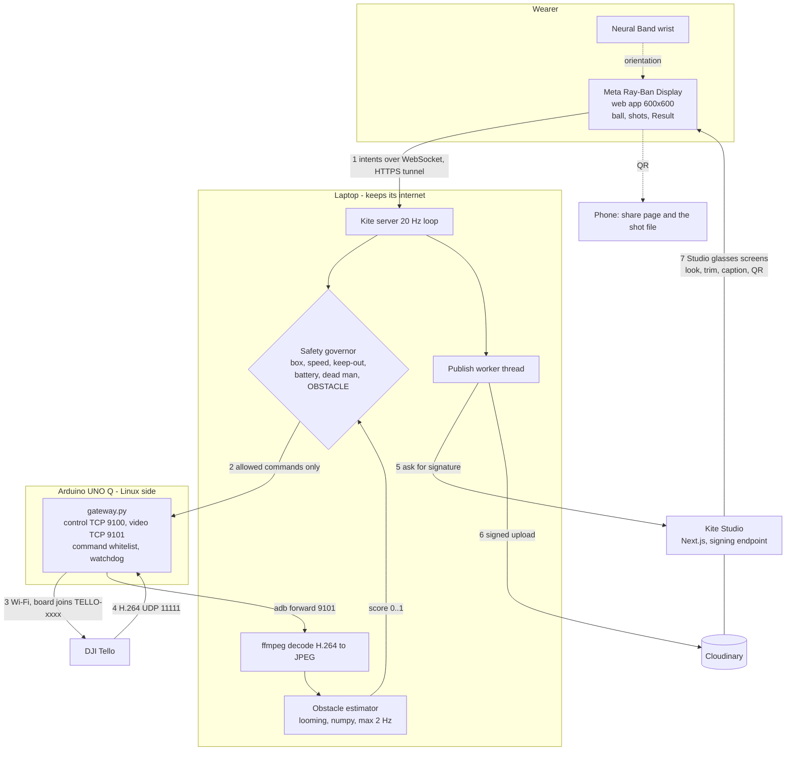

# Architecture and data flow

Status key: **VERIFIED** = run for real (hardware or live service). **SIM** = run in the simulator, fixtures or against fake servers in tests. **UNTESTED** = written, never run end to end. Sources: HANDOFF.md, bridge/unoq/README.md, ASSUMPTIONS.md, kite-studio/ASSUMPTIONS.md.

## Diagram (Mermaid)



## ASCII version

```
 Neural Band ..> [Glasses web app] --intents, WebSocket (HTTPS tunnel)--> [Kite server, laptop]
                                                                              |
                                  obstacle score 0..1 --> [GOVERNOR] <--------+  every command passes here
                                          ^                   | allowed only
                       [estimator, 2 Hz]  |                   v
                                  ^       |        [UNO Q gateway.py]  control 9100, video 9101 (adb forward, USB-C)
                       [ffmpeg JPEG] <----+------------------ |  ^
                                                   Wi-Fi      v  |  H.264
                                                          [DJI Tello]

 after landing:  [Kite publish thread] -sign?-> [Studio] ; -signed upload-> [Cloudinary]
                 [Studio /glasses] -> look, trim, caption -> QR on lens -> [Phone: share page + shot file]
```

## Link status

| # | Link | Status | Evidence or gap |
|---|---|---|---|
| 1 | Glasses web app to Kite (WebSocket, token, HTTPS via Tailscale Funnel) | VERIFIED | About 1 hour on real glasses; `/g/<code>` links [HANDOFF.md] |
| 1b | Neural Band wrist orientation to the ball | UNTESTED | Axis fit and press/release not verified on a real band [HANDOFF.md] |
| 2 | Governor to drone adapter | VERIFIED (sim and ESP32 bridge) | `Runner._apply` only caller; `tests/test_no_bypass.py`; real flights logged in `flightlog.jsonl` |
| 2b | Governor OBSTACLE rule (hold at 0.65) | SIM | Unit tests and synthetic footage; never in flight [ASSUMPTIONS.md section 6] |
| 3 | Laptop to UNO Q to Tello control | UNTESTED | Gateway tested with fakes only [bridge/unoq/README.md]. The real drone has flown through an ESP32 bridge on COM24 instead |
| 4 | Tello H.264 through the board to the laptop | UNTESTED | Needs `streamon`, ffmpeg latency and throughput check [bridge/unoq/README.md] |
| 4b | Estimator on the board itself | UNTESTED | Today wired in Kite's server on the laptop; `tools/bench_edge.py` is written to run on the board (docker) but no result is recorded |
| 5-6 | Publish: Kite asks Studio to sign, uploads to Cloudinary | SIM | Fake Studio and Cloudinary servers on localhost; no live upload, no credits spent [README.md, kite-studio/ASSUMPTIONS.md] |
| 7 | Studio `/glasses` screens | SIM | Fixture mode, screenshots `glasses-01` to `07`; not on real glasses |
| 8 | QR to phone share page | SIM | QR drawn client side; phone scan not done |
| 9 | Shot file on share page imported back into Kite | SIM | Tested offline |

## What runs where (honest summary)

- Laptop: Kite server, governor, planner, estimator (today), ffmpeg, publish worker.
- UNO Q Linux side: `gateway.py`, standard library Python, no internet needed while flying. The board loses its own Wi-Fi to the venue when it joins the Tello; adb over USB stays up.
- UNO Q MCU side: not used (see PROJECTHUB.md).
- Cloud: only after landing, by choice: Studio and Cloudinary. One video frame leaves the laptop only when the wearer asks "what do you see" (vision model); the glasses camera is never used.

## Safety chain in one line

Every command passes the governor; the board adds a command whitelist, rc clamp and a dead-man watchdog (hover after 1.5 s, land after 6 s of laptop silence while airborne) [bridge/unoq/README.md]; the obstacle rule only holds forward motion.
