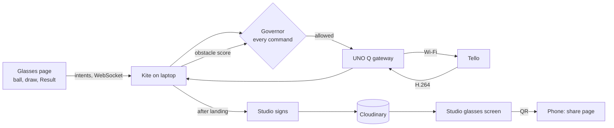

# Kite: storyline

Private working file. Every claim below is traceable to the repo (file names in brackets). Read `CHECKLIST.md` for what we must not say.

## One-sentence pitch

**Kite lets one person fly a drone, shoot a cinematic move, edit it and share it, using nothing but Meta Ray-Ban Display glasses: you draw the move in the air, a safety governor and an edge board keep the drone honest, and a QR code on your lens puts the finished film on a friend's phone.**

Shorter, for a slide: *Draw a camera move once. Fly it anywhere. Share the film from your glasses.*

## The human

Aino (a persona, not a real person) coordinates volunteers for a small wetland restoration project. Funders and neighbours want to see what the place looks like and how it is changing. She cannot pay a film crew, hire a helicopter, or learn a drone controller and an editing suite. She has one small drone and a pair of glasses.

## The problem

Good footage of a local place needs three skills and three tools: piloting, composing a camera move, and editing and sharing. Each lives on a different device, and the pilot's hands and eyes are busy. Small local projects (nature, farms, NGOs, community groups, local shops) go without footage, or shoot something shaky once and never repeat it.

## What we changed

A shot is a short, named, readable file of relative moves [README.md]. The shot library is the product; flight is playback. Control, studio, editing and sharing all happen from the glasses.

## The hero moment

Aino pinches, holds the ball, and draws an arc in the air in front of her. The drone flies that arc, smoothed [kite/planning/README.md], and stops by itself when something is ahead (amber light). She orbits a teammate and lands. She presses Publish on the lens. A little later a friend scans the QR code floating in her glasses, and the film plays on the friend's phone with the look she chose. No laptop touched, no crew.

## Narrative arc

1. Hook: a small place, no budget, no crew.
2. Put on the glasses. The ball is the controller.
3. Draw the move. The governor shows its verdict before takeoff.
4. The drone refuses to be reckless: it holds when something is ahead.
5. Orbit the person. Land.
6. Publish, edit (named look, trim, caption), share by QR.
7. Honest close: what flew, what is simulated, what is next.

### 90-second spoken version

"Small local projects need good footage of their place and cannot afford a crew. Kite is a drone studio you wear. With Meta Ray-Ban Display glasses I pinch, hold a ball, and draw the camera move in the air. Kite smooths it into a flight arc. Before anything moves, a safety governor checks it, and it refuses with a reason rather than clipping the move. The drone flies the arc. If something is ahead, the drone holds, and an amber light tells me why. That judgement is made from the video, with no cloud, and we are moving it onto an Arduino UNO Q next to the drone. The board is also the drone's gateway: it joins the drone's Wi-Fi so the laptop keeps its internet. I orbit a teammate and land. Then, from the glasses, I publish to Cloudinary, choose a named look, trim, add a caption, and a QR code appears on the lens. My friend scans it, and the film plays on her phone. The move itself is a small file, so she can fly the same shot at her own place. We flew a real drone and wore real glasses for about an hour; some pieces are simulator-tested only, and we say which."

(Say "runs on the UNO Q" only if the benchmark has been run on the board; see CHECKLIST.md item 9. Today the estimator is wired into Kite's server on the laptop [kite/server.py], and `tools/bench_edge.py` is written to run on the board.)

### 30-second spoken version

"Small local projects cannot afford a film crew. Kite lets one person draw a camera move in the air with Meta Ray-Ban Display glasses, fly it with a drone that a safety governor and an Arduino UNO Q keep in check, then publish, edit and share the film by QR code, all from the glasses. The shot is a file, so the same move can be flown again to show how a place changes."

## Three challenges, mapped honestly

| Challenge | What we built | Judging criteria it hits | What to show |
|---|---|---|---|
| Meta Ray-Ban Display | A 600x600 web app: one ball, pinch to take off, press-hold to move, Land and Stop, Result view with Publish; Studio's `/glasses` for edit and QR. Wrist (Neural Band) mapping written to the documented API, not verified on a real band. Display simulator used; real glasses tested about 1 hour [HANDOFF.md]. | Fits the display (additive black, native buttons, thumb slide and pinch only), a task that needs hands-free, glasses camera deliberately unused (privacy) [ASSUMPTIONS.md]. | Glasses footage of take-off and ball; `docs/screens/10-glasses-flying.png`, `result-view-600.jpg`. |
| Cloudinary | Kite Studio: Next.js Starter Kit plus Skills Pack; signed uploads; named transformations kite-noir, kite-spotlight, kite-steady; trim and caption overlays; share page carrying the camera move as a file; publish from the glasses via Studio's signing endpoint [kite-studio/README.md]. 189 offline tests. | Production readiness (signing deny-list, rate limit, 100 MB guard, credit-aware renders), inventive media use (the shot file travels with the video). | Studio, `glasses-03-look-noir.jpg`, `glasses-06-share-qr.jpg`, `04-shared-page.png`. **Not yet run against a live Cloudinary account** [kite-studio/ASSUMPTIONS.md]: do it before filming. |
| Arduino UNO Q, Edge AI | Board as Tello gateway (control and H.264 video over adb) [bridge/unoq/README.md]; looming obstacle estimator (numpy, no network) feeding the governor's OBSTACLE rule [ASSUMPTIONS.md section 6]; trajectory planner; person tracker and follow logic [kite/subject/README.md]. | Local processing, a physical-AI loop, honest limits, a credible local-benefit story. Must also be on Arduino Project Hub with tag `Junction Finland 2026`. | Board on the desk, amber hold, gateway log. **Gateway never run on the board with a drone** [bridge/unoq/README.md]. |

## Architecture in plain words

The glasses page sends intents (take off, move, fly a shot) over a WebSocket to Kite on the laptop. Every intent goes through the governor, plain code that checks a safety box, speed, height, a keep-out around a person, battery, a dead-man timer and the obstacle rule. Only governor-approved commands reach the drone adapter [tests/test_no_bypass.py]. The adapter talks to the UNO Q, which has joined the Tello's Wi-Fi, so the laptop stays online. Video returns through the board; an estimator watches the centre of the frame for things growing larger and raises a 0..1 obstacle score. At 0.65 or more, forward motion becomes a hover with the reason "something ahead" [kite/governor.py]. After landing, Kite exports, asks Studio to sign each upload (the Cloudinary secret stays in Studio), uploads to Cloudinary, and Studio's glasses screen offers looks, trim, caption and a QR for a phone. Full diagram with verified/untested marks: `ARCHITECTURE.md`.

## Why now, why us

- Now: Display glasses with a wrist band are a new hands-free surface with real input; the UNO Q is a Linux board with an MCU, small enough to ride beside a drone.
- Us: we built the whole chain, not a slice: input, safety, flight, edge, media, share. 185 tests in Kite and 189 in Studio pass offline [HANDOFF.md, kite-studio/README.md]; we flew a real Tello and wore real glasses on 14 Nov, and the hardware bugs we found are fixed with tests [HANDOFF.md].

## Green framing options

None of these is a measured saving. We say so on stage.

**A. Footage without the footprint.** Small projects film their own place with one light drone instead of hiring crews, vehicles or helicopters. Strength: easy to grasp, true as a direction. Weakness: invites "show me the number", and we have none; a toy drone is also not a survey tool.

**B. Watching change in a place, over time (recommended).** A shot is a file, so the same move can be flown again next season and compared: restoration sites, shorelines, a farm's hedgerow. Strength: this is the part only Kite does, it is demonstrable (save a shot, fly it again, share the move), and it supports monitoring and storytelling for flora and fauna projects. Weakness: Tello position is dead-reckoned from takeoff, not georeferenced, so repeats are similar, not identical. Say "repeatable move", not "survey grade".

**C. Local-first, private Edge AI.** Obstacle judgement and flight control stay on local hardware; no live video of people goes to a cloud; footage uploads only after landing, by choice. Strength: genuine and checkable. Weakness: a privacy and independence argument more than a green one, and Cloudinary publish is a cloud step.

**Recommendation: B as the headline, A as who benefits, C as how.** Wording: "Kite helps small local projects show how a place changes, season after season, without a crew, using one drone, glasses, and a board that keeps the thinking local. This is a framing, not a measured saving."
